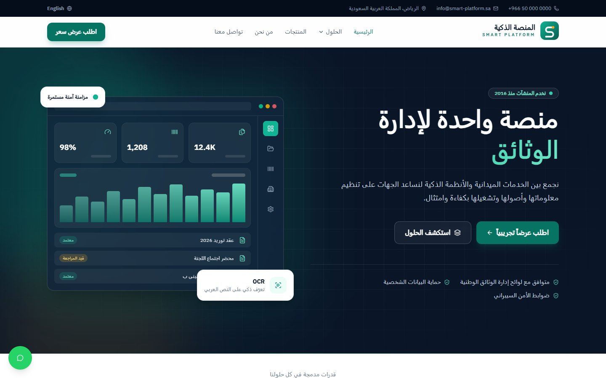
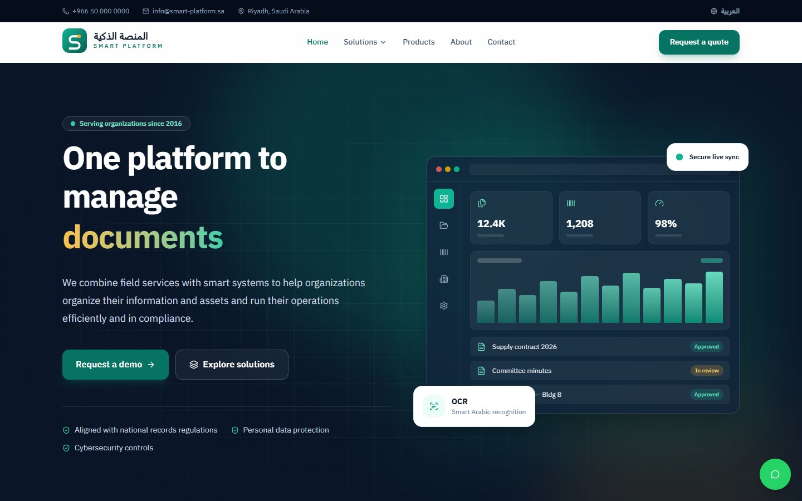
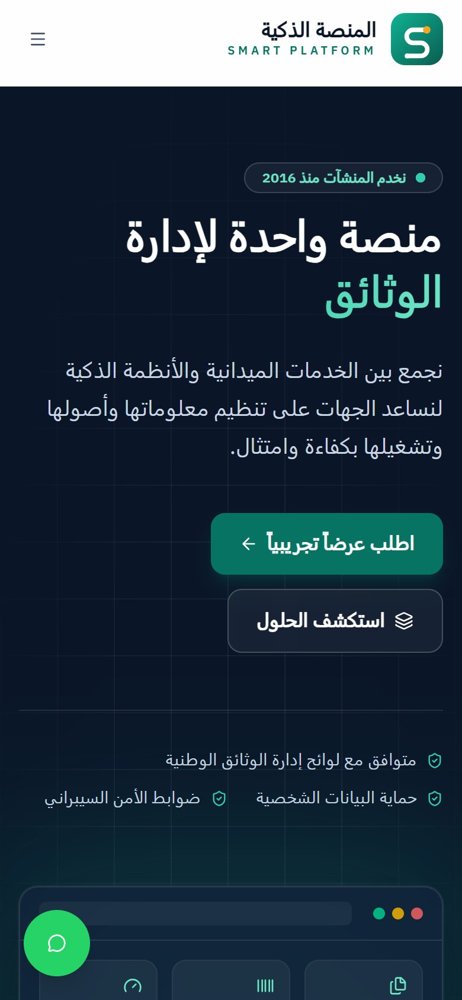
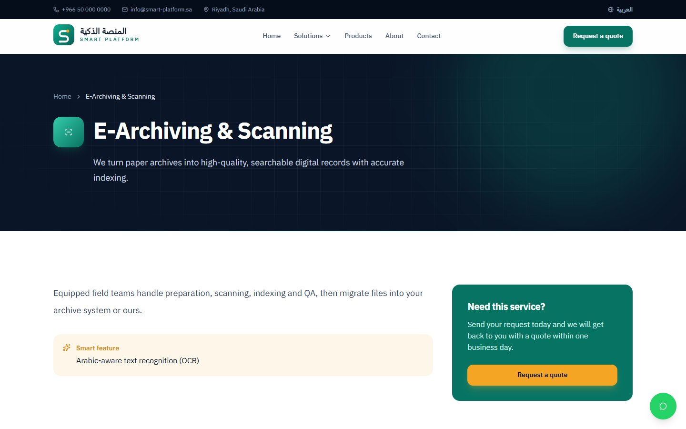
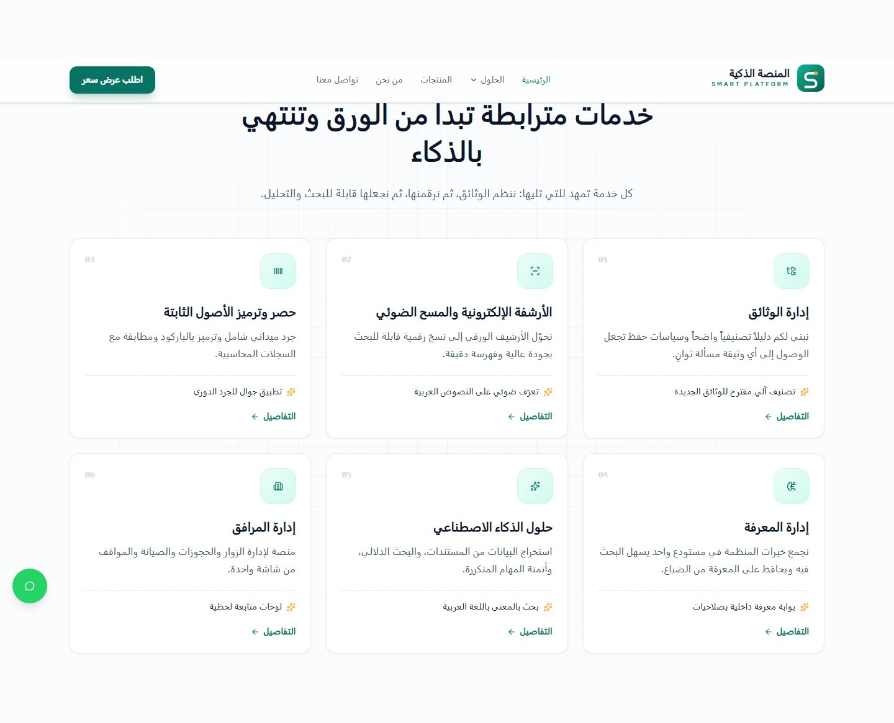
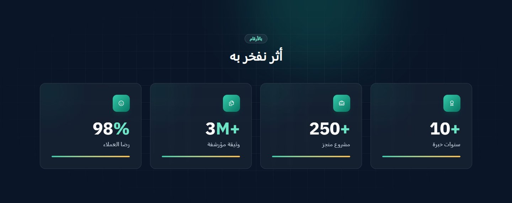
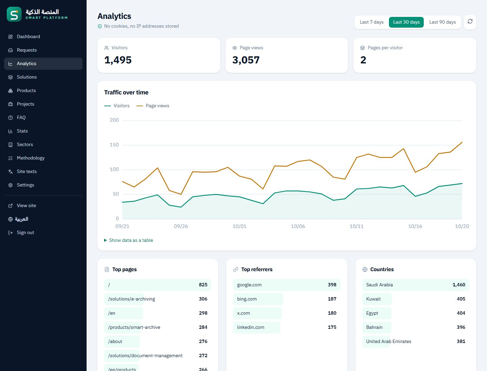
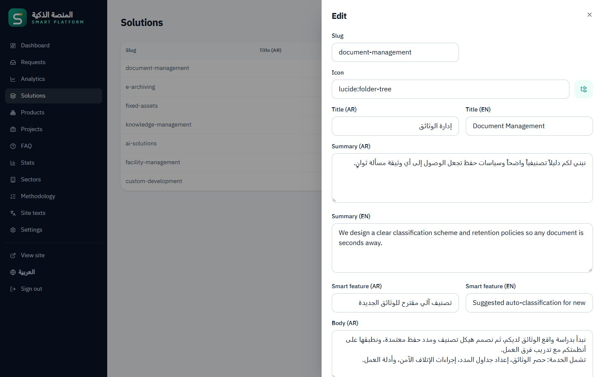
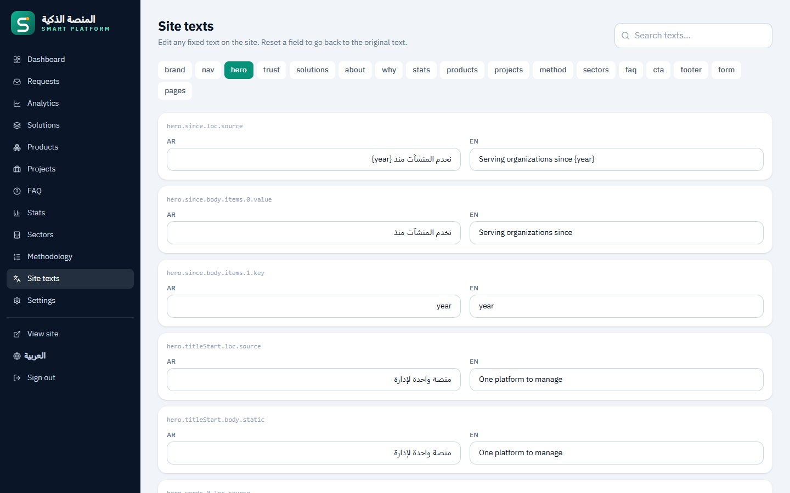

<div align="center">


# المنصة الذكية — SMART PLATFORM

**A bilingual (Arabic RTL / English) corporate website with a built-in admin panel.**
Nuxt 4 · Tailwind CSS 4 · SQLite (Turso) · Netlify

[Live site](https://smartplat.netlify.app) · [English version](https://smartplat.netlify.app/en)

</div>

<p align="center">
  
  
</p>

## Features

**Public site**
- Arabic (right-to-left, default) and English (`/en`), switchable from any page
- Home page: hero, capabilities strip, solutions, about, why us, animated stats, products, projects, methodology, sectors, FAQ and call-to-action
- Pages for every solution and product, plus About, Contact, Projects, Privacy and Compliance
- Contact, quote, demo and product-trial forms with validation, a spam honeypot and rate limiting
- Floating WhatsApp button, with the number set from the admin panel
- Responsive down to phone width, with reduced-motion support
- Lighthouse scores of 100 for accessibility, best practices and SEO

**Admin panel (`/admin`)**
- Dashboard with request counts
- Requests inbox: filter by status, mark in progress or done, delete
- **Built-in analytics:** visitors, page views, top pages, referrers, countries, devices and language. No cookies and no IP addresses are stored, so no cookie banner is needed.
- Edit solutions, products, projects, FAQ, stats, sectors and methodology steps in both languages
- **Site texts:** override any fixed text on the site (headlines, section titles and so on) per language, with reset to default
- Settings: phone, email, WhatsApp, address, working hours and map link

**Performance and SEO**
- Public pages are cached on Netlify's CDN, and every admin edit clears the cache automatically
- Social share images in both languages, plus Google structured data (Organization, WebSite and FAQ)
- Canonical links, `hreflang` alternates, and a sitemap covering both languages and every solution and product

## Screenshots

| Mobile (Arabic) | Solution page |
| :---: | :---: |
|  |  |




### Admin panel


<p align="center"><sub>Analytics dashboard (local demo data)</sub></p>

| Content editor | Site texts |
| :---: | :---: |
|  |  |

## Tech stack

| Area | Choice |
| --- | --- |
| Framework | [Nuxt 4](https://nuxt.com) (Vue 3, TypeScript) |
| Styling | Tailwind CSS 4, IBM Plex Sans Arabic, [Lucide](https://lucide.dev/icons) icons |
| i18n | `@nuxtjs/i18n` (Arabic default, English under `/en`) |
| Database | SQLite through libSQL: a local file in development, [Turso](https://turso.tech) in production |
| ORM | Drizzle ORM + drizzle-kit migrations |
| Auth | `nuxt-auth-utils` (encrypted cookie session, scrypt password hash) |
| Hosting | Netlify (serverless functions + CDN cache) |

## Quick start (local)

```bash
npm install
cp .env.example .env                              # then fill in the values below
npm run hash-password -- "your-admin-password"    # paste the printed line into .env
npm run db:setup                                  # creates ./data/local.sqlite, runs migrations, seeds content
npm run dev                                       # http://localhost:3000
```

- Arabic: `/` · English: `/en` · Admin: `/admin`
- `NUXT_SESSION_PASSWORD` must be at least 32 random characters, for example from:
  `node -e "console.log(require('crypto').randomBytes(32).toString('hex'))"`

## Scripts

| Command | What it does |
| --- | --- |
| `npm run dev` | Dev server |
| `npm run build` | Production build (Netlify preset) |
| `npm run db:generate` | Create a migration after editing `server/db/schema.ts` |
| `npm run db:migrate` | Apply migrations (to the local file, or to Turso when `TURSO_DATABASE_URL` is set) |
| `npm run db:seed` | Fill **empty** content tables with starter content. Safe to re-run on a live database. |
| `npm run db:seed -- --reset` | **Wipe** and re-fill all content tables (requests and analytics are kept) |
| `npm run hash-password -- "pw"` | Print a `NUXT_ADMIN_PASSWORD_HASH=` line |

To run a script against Turso, point dotenv at a file holding the Turso credentials:
`DOTENV_CONFIG_PATH=.env.turso npm run db:migrate`

## Project layout

```
app/
  components/home/     Home page sections
  components/layout/   TopBar, SiteHeader, SiteFooter, LangSwitch, WhatsAppFloat
  components/ui/       Cards, PageHeader, RequestForm, BrandLogo
  components/admin/    TrafficChart
  pages/               Public pages + /admin (client-rendered)
  plugins/             page-texts (admin text overrides), analytics.client (page views)
  assets/css/main.css  Tailwind theme: brand colors live in @theme
i18n/locales/          ar.json / en.json: default UI text
server/
  db/schema.ts         Tables (bilingual columns *_ar / *_en)
  api/public/          Read-only content API (CDN-cached)
  api/requests.post.ts Contact / quote / demo / product form
  api/track.post.ts    Cookie-less analytics endpoint
  api/admin/           Login, CRUD, analytics (protected by server/middleware/admin-auth.ts)
  utils/               db, rate limiting, cache purge, password hashing
scripts/               migrate, seed, hash-password
```

## How it works

- **Content** lives in the database, so you edit it in `/admin`. **Fixed UI text** defaults live in `i18n/locales/*.json` and can be overridden per language in **/admin → Site texts**.
- **Caching:** public pages and `/api/public/*` are cached on Netlify's CDN (`routeRules` in `nuxt.config.ts`, cache tag `site`). Every deploy and every admin save (`purgeSiteCache()` in `server/utils/cache.ts`) clears the cache. Admin pages, admin APIs, forms, tracking and the session endpoint are never cached. The admin session only loads inside `/admin`, so it can never end up in cached HTML. If you add an admin endpoint that changes public content, call `await purgeSiteCache()` after the write.
- **Analytics:** each page view sends a beacon to `/api/track`. The server stores the path, language, device type, referrer domain, country (from Netlify) and a daily-rotating hash of the IP and user agent, so it can count unique visitors without cookies or stored IPs. Bots, admin pages and visitors with Do Not Track enabled are skipped. Data older than about 13 months is pruned automatically.
- **Rate limits:** forms allow 5 per 10 minutes, admin login allows 5 attempts per 15 minutes, and tracking allows 120 per 10 minutes, all per IP. Limits are stored in the database, so they hold across serverless instances.
- **Projects** start as unpublished examples marked `[Example]`. The Projects menu link and home section appear automatically once at least one project is published.

## Deploying to Netlify with Turso

1. **Create the database** at [turso.tech](https://turso.tech). Pick a US East location, close to Netlify's functions, and create a database token.
2. **Migrate and seed** from your machine, with the credentials in `.env.turso`:
   ```bash
   DOTENV_CONFIG_PATH=.env.turso npm run db:setup
   ```
3. **Import the GitHub repo in Netlify.** Build settings come from `netlify.toml`.
4. **Set these environment variables** in Netlify (Import from a .env file works):
   `TURSO_DATABASE_URL`, `TURSO_AUTH_TOKEN`, `NUXT_SESSION_PASSWORD`, `NUXT_ADMIN_PASSWORD_HASH`
5. **Deploy.** Every push to `main` deploys automatically.

When the schema changes, run `DOTENV_CONFIG_PATH=.env.turso npm run db:migrate` **before** pushing the code that uses it.

## Before going live checklist

- [ ] Replace the placeholder phone, email, WhatsApp and address in **/admin → Settings**
- [ ] Replace the starter numbers in **/admin → Stats**
- [ ] Turn the `[Example]` projects into real ones (or delete them) in **/admin → Projects**
- [ ] Review the privacy and compliance text (`app/pages/privacy.vue`, `compliance.vue`)
- [ ] If you add a custom domain, update `site.url` and `i18n.baseUrl` in `nuxt.config.ts`
